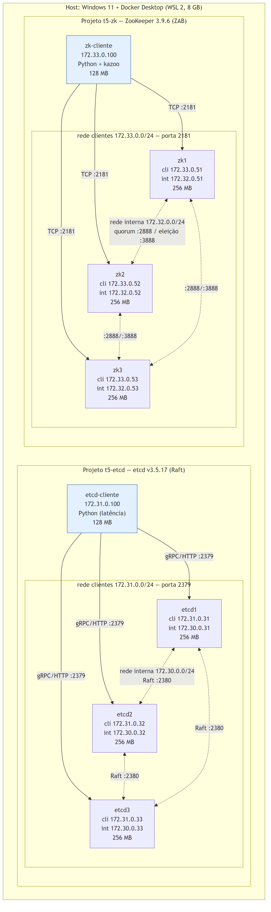

# 4. Ambiente e reprodutibilidade

## 4.1 Hardware e software (coletado em 24/10/2026)
| Item | Valor |
|---|---|
| CPU | Intel Core i7-1355U (13ª geração) |
| RAM do host | 15,7 GB (8 GB disponíveis à VM do Docker/WSL 2, 12 CPUs) |
| Sistema operacional | Windows 11 Pro; Docker Desktop com WSL 2 (kernel 5.15.167.4-microsoft-standard-WSL2) |
| Docker / Compose | Docker Engine 29.7.2 / Compose v5.5.1 |
| etcd | 3.5.17 (imagem `quay.io/coreos/etcd:v3.5.17`, 85,4 MB) |
| ZooKeeper | 3.9.6 (imagem `zookeeper:3.9.6`, 461 MB), OpenJDK 17.0.20.1 |
| Cliente ZK | `python:3.12-alpine` (74,7 MB) + kazoo 2.10.0 |

Evidência: `docs/ambiente/evidencias/`.

## 4.2 Topologia
Duas redes por laboratório: **interna** (só tráfego de consenso) e **clientes**. Isolar um nó da rede interna simula a partição
sem perder o acesso do cliente a ele.

| Nó | Rede interna | Rede clientes | Portas | mem_limit |
|---|---|---|---|---|
| etcd1 | 172.30.0.31 | 172.31.0.31 | 2380 pares / 2379 clientes | 256 MB |
| etcd2 | 172.30.0.32 | 172.31.0.32 | 2380 / 2379 | 256 MB |
| etcd3 | 172.30.0.33 | 172.31.0.33 | 2380 / 2379 | 256 MB |
| zk1 | 172.32.0.51 | 172.33.0.51 | 2888 quorum, 3888 eleição / 2181 | 256 MB (heap 128 MB) |
| zk2 | 172.32.0.52 | 172.33.0.52 | 2888, 3888 / 2181 | 256 MB |
| zk3 | 172.32.0.53 | 172.33.0.53 | 2888, 3888 / 2181 | 256 MB |
| etcd-cliente | — | 172.31.0.100 | — | 128 MB |
| zk-cliente | — | 172.33.0.100 | — | 128 MB |

**Método de medição de latência.** Os tempos de `put`/`get` (etcd) e `set`/`get` (ZooKeeper) são medidos por um cliente Python dentro da rede de clientes (`etcd-cliente` e `zk-cliente`), com `time.perf_counter`, uma conexão persistente com **um único** membro e a 1ª operação descartada como aquecimento.
- No etcd, o cliente usa a API HTTP/JSON (gRPC-gateway).
- No ZooKeeper, usa o kazoo 2.10.0.

Cronometrar no host com `docker exec etcdctl` foi descartado. Cada chamada cria um processo e uma conexão nova, e o overhead medido (cerca de 400 ms) é aproximadamente 100 vezes maior que a própria operação (achado A3, `docs/ambiente/evidencias/2026-10-25_1035_teste_ferramenta_latencia.txt`).

Fonte: `diagramas/topologia.mmd` (Mermaid); para gerar o PNG: `diagramas/renderizar.sh`. O caminho de uma escrita está em `diagramas/sequencia-escrita.png` (E2).

## 4.3 Memória medida
| Situação | etcd (por membro) | ZooKeeper (por servidor) | Evidência |
|---|---|---|---|
| Repouso (24/10/2026) | 23,7–29,7 MB | 46,8–55,7 MB | `docs/ambiente/evidencias/2026-10-24_1614_memoria_repouso.txt` |
| Sob carga (logo após `check perf --load=s`, 25/10) | 80,2–86,9 MiB por membro | (medir no E9) | `experimentos/E3-replicacao/evidencias/2026-10-25_1309_memoria_apos_carga.txt` |

## 4.4 Como reproduzir
Ver `README.md` na raiz (subida, validação, parada). Repositório: https://github.com/DavidSmithSouzak10/sd-t2-etcd-zookeeper (privado; acesso ao professor a combinar).
